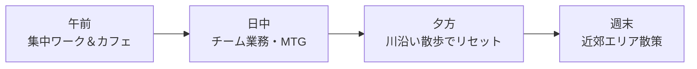

# 最近のライフスタイル共有
### 9月の月次カジュアルトーク

- **テーマ**: 最近の近況＆日常の小さな発見
- **スタイル**: リラックスしたフリートーク

---

## 1. 最近の生活で感じた3つの変化

日々の暮らしの中で改めて気づいたポイントです。

* **1) アナログとデジタルの共存**
  - 手続きや書類はアナログな文化が残りつつも、日常の決済（PayPay・Suica）はほぼ完全キャッシュレスに移行。
* **2) 静けさと配慮の文化**
  - 電車内の静けさや、公共空間でのマナー・距離感の心地よさ。
* **3) 規則正しい生活リズムの定着**
  - 曜日ごとのルールや習慣に合わせることで、自然と生活リズムが整う感覚。

---

## 2. 最近のワーク＆ライフ・ルーティン

* **お気に入りの散歩コース**: 目黒川沿い、井の頭公園周辺
* **最近の楽しみ**: コンビニの新作スイーツ巡り＆ローカルな名店開拓

---

## 3. 今月のおすすめ週末スポット：鎌倉・江ノ島

都心から電車で約1時間でアクセスできる海辺のエリアです。

* **江ノ電からの眺め**: 海沿いを走るレトロな電車と踏切の風景
* **新鮮な海鮮グルメ**: 海を眺めながら味わう生しらす丼
* **リフレッシュ効果**: 画面から離れて自然に触れることで最高の気分転換に！

---

## 4. おわりに：皆さんへの質問

* *「皆さんが最近ハマっている週末のリフレッシュ方法や趣味は何ですか？」*
* 来月も面白いトピックを準備してきます。ありがとうございました！
