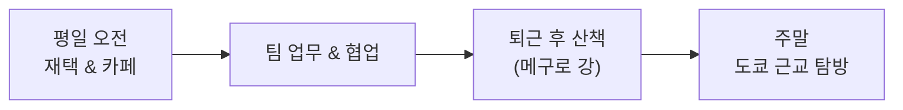

# 도쿄 일상 공유: 일본 현지 생활 이야기
### 팀원들과 함께 나누는 9월의 일상 토크

- **발표자**: 도쿄 발표자
- **주제**: 일본 생활 근황 & 일상 속 소소한 발견들
- **분위기**: 편안하고 자유로운 토크 세션

---

## 1. 일본 현지 생활에서 가장 크게 느낀 변화

도쿄로 건너와 생활하면서 한국과 비슷하면서도 달랐던 3가지 특징입니다.

* **1) 종이 문화와 디지털 전환의 공존**
  - 관공서 서류나 계약은 여전히 인감도장과 우편이 주류이지만, 상점 결제는 PayPay와 Suica로 99% 캐시리스화.
* **2) 조용함 속의 배려 (메이와쿠 문화)**
  - 전철 안에서 통화 소리가 전혀 나지 않는 침묵 문화, 줄서기 에티켓.
* **3) 분리수거와 요일별 쓰레기 배출**
  - 타는 쓰레기(燃えるゴミ), 안 타는 쓰레기(燃えないゴミ), 페트병 라벨 분리 등 철저한 규칙.

---

## 2. 최근 도쿄 생활 루틴

* **좋아하는 산책 코스**: 나카메구로 강변길, 키치조지 이노카시라 공원
* **일상의 낙**: 편의점 신상 디저트(스위츠) 맛보기 & 동네 로컬 라멘집 발굴

---

## 3. 최근 일본 체감 물가와 환율 이야기

* **엔저 지속에 따른 변화**:
  - 외식 물가는 한국 주요 상권(강남/홍대) 대비 상대적으로 저렴하게 느껴지는 편
  - 다만 전기세, 가스요금, 쌀값 등 생필품 가격 인상이 최근 뉴스 메인을 장식 중
* **팀원들이 도쿄 여행 올 때 팁**:
  - 스이카(Suica) 아이폰 애플페이 등록은 필수!
  - 100엔 숍(Daiso, Seria)에서 뜻밖의 고품질 아이템 건지기

---

## 4. 이번 달의 추천 스팟: 카마쿠라 & 에노시마

신주쿠에서 전철로 1시간 남짓이면 닿는 바닷가 마을입니다.

* **에노덴 전철**: 슬램덩크 오프닝에 나오는 유명 건널목 풍경
* **시라스동(잔멸치 덮밥)**: 바다를 바라보며 즐기는 신선한 해산물
* **다음에 팀원들이 도쿄에 오시면 함께 가고 싶은 코스 1순위!**

---

## 5. 마치며: 팀원들에게 질문

* *"여러분은 요즘 주말에 어떤 취미나 힐링을 즐기고 계신가요?"*
* 다음 달에도 재미있고 유익한 이야기 준비해 오겠습니다. 감사합니다!
