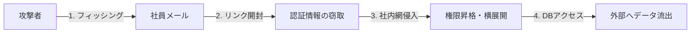

# 最近の情報漏洩事故の分析とセキュリティ対策
### 2026年10月 月次ショートプレゼン

- **テーマ**: 増加するセキュリティ脅威の理解と日常業務での対策
- **所要時間**: 約15分

> 「セキュリティ事故の80%以上は高度な技術的ハッキングではなく、些細な不注意やヒューマンエラーから始まります。」

---

## 1. 情報漏洩インシデントの現状

ここ1〜2年、国内外の主要企業における情報漏洩（データブリーチ）が急増しています。

* **主な原因の内訳**:
  1. 巧妙化した標的型フィッシングメール（42%）
  2. GitHub等の公開リポジトリへのAPIキー誤コミット（28%）
  3. クラウドストレージ（Drive / S3）の共有権限設定ミス（18%）
  4. ソフトウェア脆弱性の放置（12%）

---

## 2. 情報漏洩の典型的な侵入フロー（図解）

専門チャンネルで解説された実際の侵入シナリオを可視化しました。

> **重要ポイント**: 1人のアカウントが突破されると、攻撃者は社内ネットワーク内で「正規社員」として振る舞うため検知が非常に困難になります。

---

## 3. 代表的な3つの事故パターン

| 事故タイプ | 主な原因 | 実際の被害・影響 |
| :--- | :--- | :--- |
| **パスワード使い回し** | 他社サービスから流出したID/PWの悪用 | 社内ポータルへの不正ログイン・機密閲覧 |
| **シークレット漏洩** | GitHubへAPIキーを誤ってPush | クラウド環境の乗っ取り・高額請求の発生 |
| **設定ミス (Misconfig)** | Google Drive等のリンクを「全員に公開」 | 顧客リストや見積書が検索エンジンに露出 |

---

## 4. チームで徹底すべき5つの基本ルール

本日からチーム全員で実践したい5つの習慣です：

1. **すべての業務アカウントで二要素認証（2FA/MFA）を有効化**
2. **パスワードマネージャーの活用（使い回し厳禁）**
3. **外部共有リンクのアクセス権限を定期的に見直す**
4. **不審なメールのURL・添付ファイルは開く前にドメインを確認**
5. **Gitコミット前に `.env` やAPIキーが含まれていないか確認**

---

## 5. ディスカッション＆Q&A

今回のテーマに関連して、皆さんと共有したいトピックです：

* **Q1.** 万が一、怪しいリンクをクリックしてしまった場合の報告フローは明確ですか？
* **Q2.** 日常のファイル共有で「不便さ」と「安全性」のバランスをどう取るべきでしょうか？

> ご清聴ありがとうございました！
