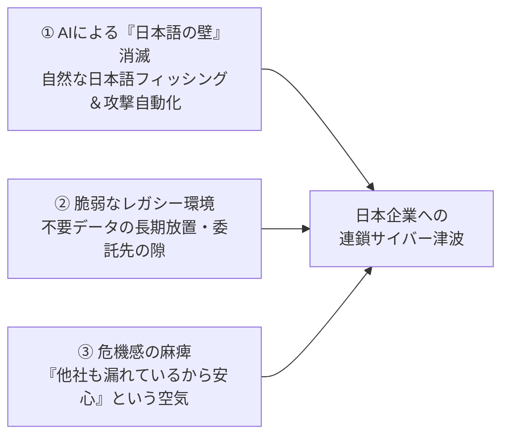

# 日本で相次ぐ大規模情報漏洩の分析
### なぜ今、日本の有名企業が次々と狙われているのか？

  

    
直近数週間の被害企業

    
20社以上

    
鉄道・流通・旅行・外食・大学

  

  

    
漏洩・懸念される個人情報

    
数千万件超

    
免許証・パスポート画像含む

  

  

    
2026年1〜9月 被害件数

    
600件突破

    
すでに前年1年間の総数を超過

  

> 「かつての単発的な被害という“波”が、現在は業界全体を飲み込む“津波（サイバー非常事態）”へと変化している」

---

  

    

      ✈ TRAVEL
      skyticket
    

    

      
事例 ① 旅行予約プラットフォーム（株式会社アドベンチャー）

      <h2 class="text-2xl sm:text-4xl font-extrabold !mb-0 !mt-0">スカイチケット（skyticket）</h2>
    

  

  

    最大 約1,464万件 漏洩の恐れ
  

* **事業概要**: 航空券・ホテル・レンタカー予約を扱う国内大手旅行予約サイト
* **事故の内容**: 外部からの不正アクセスにより、大規模な顧客データベースが侵害された可能性を発表
* **漏洩懸念データ**: 氏名・生年月日・連絡先のほか、**パスポート番号・国籍等の重要情報**が含まれる可能性
* **問題点**: 旅行プラットフォームの特性上、本人確認や渡航情報など変更が難しい機密情報が集中していた

---

  

    

      👑
      焼肉きんぐ
    

    

      
事例 ② 大手外食チェーン（株式会社物語コーポレーション）

      <h2 class="text-2xl sm:text-4xl font-extrabold !mb-0 !mt-0">焼肉きんぐ（公式アプリ）</h2>
    

  

  

    約1,079万件 会員情報漏洩
  

* **事業概要**: 全国展開する大人気焼肉食べ放題チェーン
* **事故の内容**: 公式アプリおよび会員システムへの不正アクセスにより、1,000万件を超える会員情報が流出
* **漏洩データ**: 会員の氏名、生年月日、性別、郵便番号、メールアドレス、電話番号など
* **問題点**: 日常的に利用する飲食店の「クーポン・予約アプリ」が、大規模な個人情報収集の標的となった象徴的事例

---

  

    

      Times
      CAR
    

    

      
事例 ③ 国内最大手カーシェア（パーク２４株式会社）

      <h2 class="text-2xl sm:text-4xl font-extrabold !mb-0 !mt-0">タイムズカー（Times CAR）</h2>
    

  

  

    約660万件（免許証画像160万件）
  

* **事業概要**: 日本全国で展開する最大手カーシェアリングサービス
* **事故の内容**: Webシステムへの不正アクセスにより約660万アカウントの情報が流出。うち**約160万件は運転免許証の画像データ等**の本人確認書類を含む
* **深刻な問題点**:
  1. **退会済み会員や、申し込み途中で契約に至らなかった人のデータ**まで削除せず保持し続けていた
  2. 免許証画像（顔写真・住所・生年月日・免許証番号）の流出により、金融機関でのなりすまし等**二次被害リスクが極めて高い**

---

  

    

      STATION
      LAWSON
    

    

      
事例 ④ 大手コンビニエンスストア（株式会社ローソン）

      <h2 class="text-2xl sm:text-4xl font-extrabold !mb-0 !mt-0">ローソン（LAWSON）</h2>
    

  

  

    215万件以上 の個人情報流出
  

* **事業概要**: 全国展開する大手コンビニエンスストアチェーン
* **事故の内容**: 関連Webサービス・キャンペーンシステム等への不正アクセスにより、215万件を超える顧客個人情報が流出
* **特徴と教訓**:
  - 本社基幹システムだけでなく、委託先や周辺Webサイト・キャンペーンページ等の「弱い入り口」が突破口になりやすい
  - 複数サービスで同じID・パスワードを使い回しているユーザーへの連鎖被害が懸念される

---

  

    

      IDCF
      CLOUD
    

    

      
事例 ⑤ クラウド基盤事業者（ソフトバンク子会社）

      <h2 class="text-2xl sm:text-4xl font-extrabold !mb-0 !mt-0">IDCフロンティア（IDCFクラウド）</h2>
    

  

  

    企業・自治体 495団体 が同時停止
  

* **事業概要**: ソフトバンクグループのデータセンター・クラウドインフラ提供企業
* **事故の内容**: クラウド基盤「IDCFクラウド」自体がランサムウェア攻撃を受け、利用していた**495の企業・自治体のシステムが一斉に停止**
* **深刻な問題点**:
  - 茨城県などの自治体ホームページや企業サービスが連鎖的にダウン
  - 一部環境では**「データの救出・復旧が困難であり、利用者自身のバックアップから再構築してほしい」**と発表され、クラウド丸投げの危険性が浮き彫りに

---

## ⑥ 大阪公立大学 ＆ その他の連鎖被害企業

インフラ・教育・金融・エンタメまで業種を問わず被害が拡大しています。

| ロゴ / 組織名 | 業種 | 被害規模・内容 |
| :--- | :--- | :--- |
| 🎓 **大阪公立大学** | 国公立大学 | ランサムウェア攻撃で**サーバー約500台が停止**・授業休講。学生・卒業生ら**少なくとも13万人分**の情報漏洩の恐れ |
| 🚆 **JR東日本 / JR九州** | 鉄道・交通 | 関連サービス・予約システム等への不正アクセスおよびシステム障害の波及 |
| 📈 **大和証券** | 金融・証券 | 顧客アカウントへの不正アクセス・フィッシング等の標的化により金融庁も緊急警戒 |
| 🎤 **第一興商（ビッグエコー）** | エンタメ | カラオケ会員・関連システムにおける個人情報漏洩被害 |
| 📚 **BOOKOFF / NewsPicks** | 流通・メディア | 会員情報・関連システムへの不正アクセス被害が相次いで発覚 |

---

## なぜ今、日本企業がここまで狙われるのか？

動画内で指摘されている**3つの構造的要因**と私たちの対策です。

1. **「日本語の壁」の崩壊とAI攻撃の低コスト化**: 生成AIとオープンソース攻撃ツールの普及で、わずか数十ドルのコストで自動化された攻撃が可能に
2. **「みんな漏れているから大丈夫」という危険な心理**: 20社以上が同時に被害を受ける中、麻痺せず自社の権限管理・不要データ削除を徹底することが不可欠
3. **個人とチームの防衛策**: パスワード使い回し厳禁・2要素認証（MFA）必須化・クラウド任せにしない独立バックアップの確保
