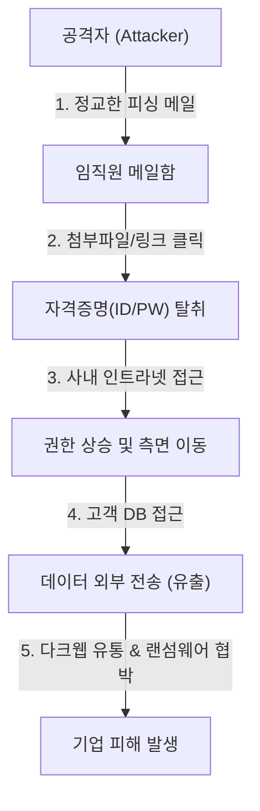

# 최근 정보 유출 사고 사례 분석과 팀 보안 수칙
### 2026년 10월 팀 정기 세미나

- **발표자**: 도쿄 발표자
- **목적**: 최근 증가하는 정보보호 위협을 이해하고 업무상 보안 실천 방안 점검
- **소요 시간**: 약 15분

> "보안 사고의 80% 이상은 기술적 해킹이 아니라, 사소한 부주의와 사람의 취약점에서 시작됩니다."

---

## 1. 최근 정보 유출 사고의 심각성

최근 1~2년간 글로벌 및 일본 내 주요 기업들의 정보 누출(情報漏洩) 사례가 급증하고 있습니다.

### 핵심 피해 통계
* **평균 유출 데이터**: 1건당 수만 ~ 수백만 건의 고객 DB
* **주요 피해 원인**:
  1. 임직원 사칭 피싱(Phishing) 메일 (42%)
  2. GitHub 등 공개 저장소에 API 키 / 비밀번호 커밋 (28%)
  3. 클라우드 스토리지(S3, Drive) 잘못된 공유 권한 설정 (18%)
  4. 구형 소프트웨어 취약점 미패치 (12%)

---

## 2. 유튜브 핵심 요약: 정보 유출 침투 경로

전문 보안 채널에서 분석한 실제 침투 시나리오를 다이어그램으로 시각화했습니다.

> **핵심 교훈**: 한 명의 계정이 뚫리면 공격자는 사내망 내부에서 정상 직원처럼 활동하므로 감지가 매우 어렵습니다.

---

## 3. 대표적인 실제 사고 유형 3가지

| 사고 유형 | 주요 원인 | 실제 피해 사례 및 영향 |
| :--- | :--- | :--- |
| **자격증명 재사용** | 타 사이트에서 유출된 ID/PW 대입 | 사내 포털 무단 접속 및 기밀 문서 열람 |
| **소스코드 키 유출** | GitHub에 API Key 실수로 업로드 | 클라우드 계정 장악 및 대규모 과금 발생 |
| **설정 오류 (Misconfig)** | Google Drive / S3 링크 전체공개 | 고객 정보 및 견적서 검색엔진에 노출 |

---

## 4. 우리 팀이 즉시 실천해야 할 5대 보안 수칙

오늘부터 우리 팀 전원이 지켜야 할 기본 수칙입니다:

1. **모든 업무 계정에 2단계 인증(2FA/MFA) 필수 적용**
   - 비밀번호가 유출되어도 모바일 OTP가 없으면 접속 불가
2. **패스워드 매니저 활용 (1Password, Bitwarden 등)**
   - 개인 사이트와 회사 업무 사이트 비밀번호 절대 동일 사용 금지
3. **외부 공유 링크 권한 재확인**
   - '링크가 있는 모든 사용자' 대신 '특정 이메일 사용자만' 접근 허용
4. **의심스러운 메일 링크 및 첨부파일 주의**
   - URL 도메인 스펠링 확인 (`g00gle.com`, `amaz0n-verify.jp` 등)
5. **Git 커밋 전 `.env` 및 시크릿 키 체크**
   - `.gitignore` 설정 철저히 확인

---

## 5. Q&A 및 토론 주제

오늘 발표 내용을 바탕으로 가볍게 이야기해 보고 싶은 주제입니다:

* Q1. 업무 중 실수로 의심스러운 링크를 눌렀을 때, 우리 팀의 보고 절차는 어떻게 되어 있나요?
* Q2. 사내 파일 공유 시 권한 관리를 더 안전하고 편하게 할 방법은 무엇일까요?

> **"보안은 불편함과의 타협이 아니라, 팀의 신뢰를 지키는 가장 튼튼한 방패입니다."**  
> 경청해 주셔서 감사합니다!
